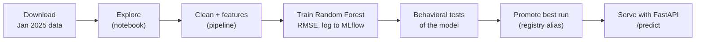

# NYC Yellow Taxi: Trip Duration Model, from Data to API

Predict how long (in minutes) a New York City yellow taxi trip takes, from the January 2025 trip records. The project covers the whole path: explore the data, build a tested cleaning pipeline, train and track a model, promote the best one, and serve it through a local API.

Stack: `pandas` (data pipeline), `scikit-learn` `RandomForestRegressor` (model), `MLflow` (experiment tracking and model registry), `FastAPI` (serving), `pytest` (103 tests). The assignment is in [project-description.md](project-description.md).

## Results at a glance

| | |
|---|---|
| Data | January 2025 yellow taxi trips: 3,475,226 rows, 3,338,899 kept after cleaning (96.1%) |
| Model | Random Forest, 50 trees, `min_samples_leaf=100` (57 MB) |
| **Validation RMSE** | **4.14 minutes**; always predicting the average gives 9.77 |
| Typical trip | median duration 11.7 minutes, so the error is about a third of a typical trip |
| Serving | `POST /predict` on `http://127.0.0.1:8000`; the sample request predicts 17.49 minutes |
| Tests | 103: cleaning rules, features, pipeline, training, model registry, API, and behavior of the trained model |
| Not done | hyperparameter tuning (stretch task) and a few experiments, see [Open points](#open-points-and-what-i-would-do-differently) |

The honest caveats are in [Trade-offs and limitations](#trade-offs-and-limitations). The most important one: the model uses `trip_distance`, which is only known when the trip ends.

## Workflow



## Quickstart

```bash
uv sync                                                                   # environment and packages
uv run python -m taxi_ml.pipeline                                         # download, clean, features -> data/processed/
uv run python -m taxi_ml.train                                            # train, evaluate, log to MLflow (about 20 s)
uv run python -m taxi_ml.promote                                          # register the best run, set alias 'production'
uv run uvicorn app.main:app --port 8000                                   # serve (docs: http://127.0.0.1:8000/docs)
curl -X POST http://127.0.0.1:8000/predict -H "Content-Type: application/json" -d @sample-request.json
uv run pytest                                                             # all tests
uv run mlflow ui --backend-store-uri sqlite:///mlflow.db --port 5000      # optional: look at the runs
```

Everything runs from the terminal; no other program is needed (a browser only for the optional MLflow UI and the API docs). The data, `mlflow.db` and `mlartifacts/` are not committed, so a fresh clone needs the first four commands before the API can start. On Windows PowerShell use `curl.exe` instead of `curl`.

## Where the assignment steps are

| Assignment step | Where in this repo |
|---|---|
| 1. Load and inspect the data | Step 1, notebook |
| 2. Clean training data, define the target | Step 2, `clean.py` |
| 3. Train/validation split | Step 3, `train.split_data()` |
| 4. Baseline Random Forest | Step 3, `train.train_baseline()` |
| 5. RMSE and MLflow | Step 3, `train.run()` |
| 6. Reusable modules for features and model loading | `features.py` (used by pipeline and API), `registry.py`; Step 5 |
| 7. FastAPI with `/predict` | Step 6, `app/` |
| 8. Run locally, send a request | Step 6 |
| 9. Document results and trade-offs | this README |
| Stretch: tests | Steps 2 to 6 (103 tests, including behavioral tests) |
| Stretch: tuning and comparison | not done, see [Open points](#open-points-and-what-i-would-do-differently) |

The step numbers in the log below are this README's own (the order I built things in), not the assignment's.

## Setup

Requirements: [uv](https://docs.astral.sh/uv/getting-started/installation/) and the Python version in [`.python-version`](.python-version).

```bash
uv sync
```

Open the notebook with the kernel from `.venv/` that `uv sync` creates.

## Project structure

```
data/raw/               downloaded parquet files, never edited (ignored by git)
data/processed/         cleaned features + target, written by the pipeline (ignored by git)
mlflow.db               MLflow runs, metrics and the model registry (SQLite, ignored by git)
mlartifacts/            logged models (ignored by git)
notebooks/
  01_explore_yellow_taxi.ipynb   exploration only, not part of the pipeline
src/taxi_ml/
  config.py             paths, URL, month, cleaning thresholds, feature list (settings only)
  data.py               download_month() and load_raw()
  clean.py              add_duration() and clean(): the target and the row filters
  features.py           build_features(): raw columns -> model features (shared with the API)
  pipeline.py           build_dataset() and run(): all stages in order
  train.py              split, baseline RandomForestRegressor, RMSE, MLflow logging
  registry.py           load_latest_model() (newest run) and load_production_model() (promoted version)
  promote.py            best_run() and promote(): register the best run, point the 'production' alias at it
app/
  schemas.py            request and response models with the allowed ranges (Pydantic)
  main.py               create_app(): /health and /predict, loads the production model once at start-up
sample-request.json     example body for /predict
tests/
  conftest.py           small raw-like test frame where each bad row breaks one rule
  helpers.py            shared test data (make_processed) and small model settings
  test_clean.py         unit tests for the cleaning rules
  test_features.py      unit tests for feature building
  test_pipeline.py      integration tests: load, download-skip, full run on a parquet file
  test_train.py         unit tests (split, RMSE, model) and integration tests (a run logged to a temporary MLflow)
  test_registry.py      finding and loading the newest and the promoted model
  test_promote.py       choosing and promoting the best run
  test_api.py           API tests with a stand-in model, plus one smoke test with the real model
  test_model_behavior.py  behavioral tests (MFT, INV, DIR) of the real trained model
```

## Log of steps

### Step 1: Data exploration (`notebooks/01_explore_yellow_taxi.ipynb`)

**Why a notebook first:** the cleaning rules and the feature list should come from looking at the data, not from guessing. The notebook is exploration only; its decisions are moved into `src/` as the pipeline in step 2.

**Data:** `yellow_tripdata_2025-01.parquet` from the [NYC TLC trip record data](https://www.nyc.gov/site/tlc/about/tlc-trip-record-data.page), downloaded from `https://d37ci6vzurychx.cloudfront.net/trip-data/yellow_tripdata_2025-01.parquet` into `data/raw/` (59 MB, 3,475,226 rows, 20 columns).

**Target:** `duration` = `tpep_dropoff_datetime - tpep_pickup_datetime`, in minutes.

#### Exploration findings

| Finding | Numbers | Consequence |
|---|---|---|
| Duration has impossible and extreme values | min -51,472 min, max 5,626 min; 2,051 rows with `duration <= 0`, 40,111 under 1 min, 31,867 over 60 min, 20 over 24 h. Median 11.7 min, 99th percentile 58.9 min | Keep only trips of 1 to 60 minutes. Extremes would dominate the RMSE |
| Distance has errors | 90,893 rows with distance 0, 162 over 100 miles (max 276,424) | Keep distance in (0, 100] miles |
| Month window | 22 rows have a pickup outside January (21 in Dec 2024, 1 in Feb 2025) | Filter on the pickup date, as in the Green Taxi project |
| One block of rows has five empty fields | `passenger_count`, `RatecodeID`, `store_and_fwd_flag`, `congestion_surcharge`, `Airport_fee` are all missing in the same 15.5% of rows (540,149) | Do **not** drop them, that would remove 16% of the data. Fill `passenger_count` with 1, the most common value (see step 2) |
| Passenger count | 24,656 rows with 0 passengers, 18 with more than 6 | Kept for now (they do not make the duration wrong) |
| Fares are unreliable | 145,516 rows with `fare_amount <= 0`, min -900 | Not used as features anyway (see leakage) |
| Distance carries strong signal | correlation of distance and duration (1 to 120 min trips) is 0.81 | A baseline should already work well |
| Location IDs | 261 pickup and 260 dropoff zones; the 20 most common pickup-dropoff pairs cover only 6.4% of trips | Treat as categories, not a lookup of routes |

With the three cleaning rules (month window, duration 1 to 60 min, distance in (0, 100]) **2,852,634 rows remain** if rows with a missing `passenger_count` are also dropped (82.1%). Keeping those rows instead (decision above) leaves more.

#### Feature decision and leakage

The API is called before a trip ends, so it can only use what is known at pickup. Features chosen for the baseline:

- pickup hour and pickup weekday (from `tpep_pickup_datetime`),
- `PULocationID`, `DOLocationID`,
- `passenger_count`,
- `trip_distance`.

Not used: `tpep_dropoff_datetime` (it defines the target), and all fare, tip, toll, surcharge and `payment_type` columns, because they are only known after the trip.

**Limitation:** `trip_distance` is measured by the meter during the trip, so strictly it is not known at pickup. It is the strongest predictor, so the baseline uses it. The consequence is described under [Trade-offs and limitations](#trade-offs-and-limitations).

### Step 2: Data pipeline (`src/taxi_ml/`) and tests

The notebook's decisions are now code. The flow is `download -> load -> clean -> features -> data/processed/yellow_2025-01_clean.parquet`.

```bash
uv run python -m taxi_ml.pipeline   # download (skipped if present), clean, write the processed file
uv run pytest                       # all tests (103 after step 6)
```

**Result on January 2025:** 3,475,226 raw rows -> **3,338,899 rows kept (96.1%)**. The processed file has the 6 features plus `duration`, no missing values, durations from 1 to 60 minutes. (The notebook's 82.1% figure dropped rows with a missing `passenger_count`; the pipeline keeps and fills them.)

**Design decisions**

| Decision | Why |
|---|---|
| `clean.py` and `features.py` are pure functions (DataFrame in, DataFrame out), with no paths or downloads | Easy to unit test with tiny frames, and the API can import `build_features` unchanged |
| `config.py` holds every threshold and the feature list | One place to change a rule, and training and API cannot disagree |
| Missing `passenger_count` is filled with the constant `1` in `build_features`, not with the data's median | A constant gives the same result in training and in the API; a median computed from the data would have to be saved and loaded |
| The month window is a filter on the pickup time, not on the file name | The January file contains 22 trips from neighbouring months |
| Download writes a `.part` file and renames it when complete; an existing file is skipped | A failed download never looks like a good file, and re-running is safe |
| `build_dataset()` (pure) is separate from `run()` (file access) | The integration test can check the logic without touching `data/` |
| No Prefect or Docker in the pipeline | One month on one machine; not needed for this task |

**Cleaning rules** (thresholds in `config.py`): pickup in `[2025-01-01, 2025-02-01)`; duration 1 to 60 minutes inclusive; distance above 0 and at most 100 miles; average speed at most 80 mph. Nothing else is dropped.

#### Review of the cleaning decisions (speed rule added)

After the first version of the pipeline the decisions were checked again against the data. The evidence is in notebook sections 6 to 9.

| Question | Finding | Decision |
|---|---|---|
| Drop the 15.5% rows with five empty fields? | They are not random: all have `payment_type = 0` (listed as a flex-fare trip in the TLC data dictionary, to be confirmed there), cluster in the evening and at night, and are a bit longer (median duration 13.7 vs 11.3 min, distance 2.25 vs 1.61 miles). 10% of them fail the other cleaning rules, against 3% of the rest | **Keep** them: only `passenger_count` is affected and it is probably a weak feature, and the model should know this group because the API will be asked about it. The keep-vs-drop comparison on the same validation rows was not run, see [Open points](#open-points-and-what-i-would-do-differently) |
| Duration cutoff | After the other rules, 60 min keeps 99.07% of trips, 90 min keeps 99.86%. Trips over 60 min are real (median distance 17 miles), not errors | **Keep 60 min.** It is a scope choice: the model is meant for trips up to one hour, and RMSE values are only comparable with the same cutoff |
| Extreme distance | The 100-mile cap is loose (99.9th percentile: 27 miles). Speed is the better check: 186 trips are faster than 80 mph (median 123 mph, impossible), 10,935 are slower than 0.5 mph | **New rule:** drop speed above 80 mph (185 rows in the pipeline). Slow trips are kept: their duration is still a real observation |
| Fare and total outliers | They are neither target nor features, so they cannot affect the model. Rows with `total_amount <= 0` (1.7%) have the same median duration, distance and speed as normal trips | Not cleaned |
| Passenger count 0 or above 6 | Only 8 rows above 6 remain after cleaning. The field is typed in by the driver (17k trips show 5 passengers, 12k show 6) | Not cleaned. The API will accept 1 to 6 |

The speed rule is written as `trip_distance <= 80 * duration / 60` (no division, so no division by zero). It uses information from after the trip, so it only cleans the training data and is never a feature.

**Tests**

- *Unit* (`test_clean.py`, `test_features.py`): each cleaning rule has its own test on a small frame where one row breaks exactly that rule, including the boundary (exactly 60 minutes is kept), a trip crossing midnight, the empty frame, and that inputs are not modified. Feature tests check the column order, hour/weekday, the passenger fill, and that no after-the-trip column (dropoff time, `total_amount`, `duration`) can leak into the features.
- *Integration* (`test_pipeline.py`): reads a real parquet file, checks the clear error for a missing file, that an existing file is not downloaded again (the URL is unreachable on purpose), that `build_dataset` returns matching `X` and `y`, and that `run()` writes the processed file with the right columns.
- Speed rule: a 240 mph trip is dropped, exactly 80 mph (40 miles in 30 min) is kept, 40.01 miles in 30 min is dropped.
- Checked that the tests can fail: changing the maximum duration from 60 to 61 makes 4 tests fail.
- The real download over the network is not covered by a test (it would need the network or a mocked HTTP response).

### Step 3: Baseline model, RMSE and MLflow (`src/taxi_ml/train.py`)

```bash
uv run python -m taxi_ml.pipeline    # once: creates the processed file
uv run python -m taxi_ml.train       # split, train, evaluate, log to MLflow (about 20 s)
uv run mlflow ui --backend-store-uri sqlite:///mlflow.db --port 5000   # then open http://127.0.0.1:5000
```

`train.py` has one function per stage so each can be tested alone: `load_processed()` -> `split_data()` -> `train_baseline()` -> `rmse()`, and `run()` which connects them and logs one MLflow run (experiment `yellow-taxi-duration`, run `baseline-random-forest`).

**Split:** random 80% train / 20% validation with a fixed seed (42): 2,671,119 training rows and 667,780 validation rows. The model never sees the validation rows while fitting. A random split is simplest for one month of data; a time-based split (validate on the last days) would be stricter and is a possible improvement.

**Model:** `RandomForestRegressor` with 50 trees, `min_samples_leaf=100`, `max_samples=0.5` (each tree sees half of the rows). The default settings (unlimited tree depth on 2.7M rows) would give models of 500+ MB that are slow to log and to load in the API, so the trees are kept small on purpose. Quick checks on the validation rows, before choosing:

| Settings | Fit time | Model size | Validation RMSE |
|---|---|---|---|
| 100 trees, leaf 20 | 26 s | 569 MB | 3.95 |
| 50 trees, max depth 20, leaf 20 | 14 s | 217 MB | 3.99 |
| **50 trees, leaf 100 (chosen)** | **12 s** | **57 MB** | **4.14** |
| 100 trees, leaf 200 | 21 s | 56 MB | 4.23 |

A bigger forest gains about 0.2 minutes of RMSE for 4 to 10 times the model size, so the baseline takes the small one. Hyperparameter tuning would revisit exactly this trade-off, but it was not done. (These checks were quick comparisons, not MLflow runs. Choosing on the validation set makes its RMSE slightly optimistic; there is no separate test set.)

**Result (January 2025, validation set):**

| | RMSE (minutes) |
|---|---|
| **Random Forest baseline, validation** | **4.144** |
| Random Forest baseline, training | 4.111 |
| Always predict the average duration (validation) | 9.767 |

The model's typical error is about 4 minutes on trips with a median of 11.7 minutes, less than half the error of predicting the average. Training and validation RMSE are almost equal, so the model does not overfit; if anything it is held back by the small trees.

**What is logged to MLflow:** all model parameters, `n_train`, `n_val`, the split seed, the feature list, the three RMSE values above (`rmse_val`, `rmse_train`, `rmse_val_mean_baseline`), and the model itself with an input example (signature). I checked that the local UI lists the run with these values.

**MLflow decisions**

| Decision | Why |
|---|---|
| SQLite database (`mlflow.db`) and `mlartifacts/` in the project folder, not the `./mlruns` folder suggested in the template | MLflow 3.17 refuses the `./mlruns` file store ("maintenance mode"). SQLite is the supported local option and what `mle-api-ml-deployment` uses |
| The artifact folder is set explicitly when the experiment is created | Otherwise models are saved relative to wherever the command was started |
| `skops_trusted_types=["sklearn.tree._tree.Tree"]` when logging | MLflow saves sklearn models with `skops` and refuses unknown types. Every tree model contains this one type; we train and load our own models, so we trust exactly this type and nothing else |
| The input example is logged as floats | Integer columns in a model signature reject missing values when the API is called |
| `rmse_val_mean_baseline` is logged | An RMSE alone says little; this gives the number to beat |

**Tests** (`tests/test_train.py`, 17 tests): the split has the right sizes, no overlap, aligned features and target, and is reproducible; RMSE matches a hand calculation; the model is fitted, takes parameter overrides and beats the mean predictor on data where duration depends on distance; the full `run()` logs the expected parameters and metrics to a temporary MLflow, creates the database and model files in the folder it was given, puts two runs in one experiment, and the logged model can be loaded and predicts. A missing processed file gives an error that points to the pipeline.

**Not done:** see [Open points](#open-points-and-what-i-would-do-differently).

### Step 4: Behavioral tests of the trained model (`tests/test_model_behavior.py`)

The other tests check the **code**. These check the **model**: does it behave like a taxi trip? They follow the three kinds from the course (behavioral testing, "CheckList" style):

| Kind | Idea | Tests here |
|---|---|---|
| **Minimum functionality (MFT)** | Simple cases with an obvious answer | A 0.3-mile trip is predicted under 10 min; a 20-mile trip over 25 min; a 10-mile trip at least 10 min longer than a 0.5-mile trip; all predictions stay in the 1 to 60 min range the model was trained on; every hour/weekday combination and extreme inputs (distance 0.01 and 100, locations 1 and 265, 0 or 6 passengers) give a valid number |
| **Invariance (INV)** | A change that should **not** matter must not change the prediction | Changing `passenger_count` from 1 to 2, 3 or 4 changes predictions by less than 0.5 min on average (95% of trips under 1 min); the same input gives the same output |
| **Directional expectation (DIR)** | A change that should push the prediction one way | A 50% longer distance does not shorten the trip (at least 95% of 5,000 trips, and clearly longer on average); predictions rise step by step with distance (0.5 to 15 miles); 5 pm is slower than 3 am (at least 90% of trips); a Sunday at 5 pm is not slower than a Thursday at 5 pm |

```bash
uv run pytest tests/test_model_behavior.py -v      # only the behavioral tests
uv run pytest -m "not behavior"                    # everything except them
```

**How they work**
- They test the **newest model in MLflow**, loaded with `registry.load_latest_model()`. When a tuned model is trained later, the same tests judge it, so they act as a quality gate before serving. They are skipped with a reason (not failed) if no model or no processed data exists yet.
- Starting points are 5,000 real trips sampled from the processed data; each test changes one thing and compares predictions before and after.
- A Random Forest is not smooth, so a single pair of trips can break a direction by chance. The DIR and INV tests therefore check **shares and averages**, not every single trip.
- Tolerances come from reasoning, not from the model's output: for example the passenger tolerance of 0.5 min is about an eighth of the model's 4 min RMSE. I measured the baseline first (a passenger change moves predictions by 0.02 min on average; 99.2% of trips are slower at 5 pm than at 3 am, by 4.9 min on average) and the tolerances leave room for a retrained model.

**Checked that these tests can fail.** I trained two deliberately broken models and ran the tests against them: one learned from shuffled durations (7 tests failed: the obvious-answer and directional ones) and one whose duration depended only on passenger count (10 failed, including all three invariance tests). The tests that stayed green for the shuffled model are pure sanity checks (valid range, finite numbers, passenger count irrelevant), which is expected.

**Findings and decisions**
- Repeating a prediction is not bit-identical: differences of about 1e-14 minutes appear because the forest adds its trees in parallel threads (`n_jobs=-1`). With one thread the result is identical. The test therefore uses a tolerance of 1e-9 instead of exact equality. This is floating-point noise, not a model problem.
- The prediction for a trip in the Midtown to Upper East Side example is flat from about 20 miles on (48 min for both 20 and 30 miles), because training trips are capped at 60 minutes and few are that long. The tests only require "long", not growth beyond that.
- **Not tested on purpose:** swapping pickup and dropoff zone. Predictions differ by 0.9 min on average, which is plausible (one-way streets, traffic direction), so it is not an invariance.
- The behavioral tests read the local `mlflow.db`. A fresh clone has no model, so they are skipped until `uv run python -m taxi_ml.train` has been run.

### Step 5: Promote the best model (`src/taxi_ml/promote.py`, `registry.py`)

Until now "the model" meant the newest run. That is unsafe for an API: a worse model trained tomorrow would be served without anyone deciding so. The MLflow **Model Registry** solves this: a model gets a name and numbered versions, and an **alias** (`production`) points at one version. The API loads `models:/yellow-taxi-duration@production`, and the alias only moves when someone promotes a model.

```bash
uv run python -m taxi_ml.promote     # pick the best run, register it, point 'production' at it
```

Example output on the three identical baseline runs:

```
compared 3 run(s):
  -> 05c8eed9  baseline-random-forest  rmse_val 4.144
     7a15022a  baseline-random-forest  rmse_val 4.144
     cc176704  baseline-random-forest  rmse_val 4.144
'production' now points to yellow-taxi-duration version 1 (rmse_val 4.144)
```

**Rules and decisions**

| Decision | Why |
|---|---|
| "Best" = lowest `rmse_val`, **not** the newest run | A newer run can be worse (for example a tuning experiment that overfits). Tested: a worse newest run does not take over |
| Promoting is a manual command, not part of training | A candidate should first pass the behavioral tests: `uv run pytest tests/test_model_behavior.py` judges the newest run, `TAXI_TEST_MODEL=production uv run pytest tests/test_model_behavior.py` judges the promoted one |
| Promoting twice creates no duplicate version | If the best run is already registered, its existing version is reused and only the alias is set |
| All compared runs are printed | "Best by RMSE" is only a fair comparison between runs with the same cleaning rules and the same validation split. If the duration cutoff changes, RMSE values are no longer comparable |
| `registry.load_latest_model()` stays | It is how a fresh candidate is judged before promotion |
| Clear errors | No database: "train first". No promoted model: "run `taxi_ml.promote`". Looking for a model never creates an empty database |

**Caveat:** choosing the best of several runs by validation RMSE makes that RMSE slightly optimistic (there is no separate test set). With a handful of runs the effect is small.

**Tests** (`test_promote.py`, 9; plus 5 new ones in `test_registry.py`): the lowest-RMSE run wins over a newer worse one, all candidates are listed and sorted, the alias points to the right run, version numbers, idempotence, a worse run does not take over production, a better run moves the alias to version 2, the promoted model loads by alias and differs from the newest run when that one is worse, and the error messages. One bug found by the tests: MLflow returns the version as a number, so `production_version()` converts it to text for the API.

### Step 6: FastAPI prediction service (`app/`)

```bash
uv run uvicorn app.main:app --port 8000        # needs a promoted model (step 5)
# interactive docs: http://127.0.0.1:8000/docs
curl -X POST http://127.0.0.1:8000/predict -H "Content-Type: application/json" -d @sample-request.json
```

On Windows PowerShell use `curl.exe` (plain `curl` is an alias for something else). With Python:

```python
import json, requests
requests.post("http://127.0.0.1:8000/predict", json=json.load(open("sample-request.json"))).json()
# {'predicted_duration_minutes': 17.49, 'model_version': '1'}
```

**Endpoints**

| Endpoint | Purpose |
|---|---|
| `POST /predict` | Body: `pickup_datetime` (New York local time), `PULocationID`, `DOLocationID`, `trip_distance` (miles), optional `passenger_count` (default 1). Returns `predicted_duration_minutes` and the `model_version` that answered |
| `GET /health` | `{"status": "ok", "model_version": "1"}` |

**Input validation** (`app/schemas.py`, Pydantic): zone ids 1 to 265, passenger count 1 to 6 (whole numbers), distance above 0 and at most 100 miles, a valid date. Anything else gets a `422` that names the field, and the model is never called. Unknown fields are rejected too: a misspelled `passengers` would otherwise be silently ignored and the default used.

**Design decisions**

| Decision | Why |
|---|---|
| The API calls `features.build_features()`, the same function the training pipeline used | Training and serving cannot build features differently. A test sends the same trip through the pipeline and through the API and compares the features the model receives |
| The model is loaded once, at start-up, from the `production` alias | Loading a 57 MB model per request would be slow. If there is no promoted model, the app refuses to start with a message instead of failing on every request |
| `create_app(load_model)` takes the loader as a parameter | Tests use a stand-in model that records its input, so API behavior is tested without MLflow or a trained model |
| The app lives in `app/` and imports `taxi_ml` | As in the suggested repository layout. `pythonpath = ["."]` in `pyproject.toml` lets the tests import it |
| Local-first: plain `uvicorn`, no Docker | The assignment asks for one of the two; uvicorn is the simpler one |
| No batch endpoint | Not required; one trip per request keeps the contract simple |

**Limitation (same as in step 1):** `trip_distance` is only known once the trip is over (or estimated from the route), which is why the request needs it. A real service would take it from a routing estimate. The model without `trip_distance` has not been compared yet.

**Verified by hand:** I started the server and sent requests with `curl` and Python `requests`. `/health` answered with version 1; the sample request predicted 17.49 minutes; distances of 0.5 / 2.4 / 10 / 20 miles gave 4.95 / 17.49 / 36.16 / 52.96 minutes (growing with distance); `passenger_count: 9` returned `422`.

**Tests** (`tests/test_api.py`, 27): the happy path and response shape; the default passenger count; the edges of every valid range are accepted and values just outside are rejected; missing fields, wrong types, bad dates and unknown fields give `422` and never reach the model; the feature-equality test between pipeline and API; the app refuses to start without a model; the model is loaded once for several requests; and one smoke test with the real promoted model (skipped if none exists).

## Trade-offs and limitations

| Topic | What was decided | Consequence |
|---|---|---|
| **`trip_distance` is a feature** | It is by far the strongest predictor (correlation 0.81 with duration), but the meter only knows it at the end of the trip | The 4.14 min RMSE is what the model achieves **when the distance is known**. A real "predict before the ride" service would need a routing estimate of the distance, and its error would add to the model's. A model without distance was not compared |
| **Small trees on purpose** | 50 trees with `min_samples_leaf=100`: 57 MB, 12 s to fit | About 0.2 min worse RMSE than a 569 MB forest in a quick check; the small model loads fast in the API |
| **Trips of 1 to 60 minutes only** | Longer trips are real (median distance 17 miles) but were cut as a scope decision | The model is meant for trips up to an hour, and RMSE only compares between runs with the same cutoff |
| **The 15.5% rows with missing fields are kept** | They are a different kind of trip (`payment_type = 0`), and only `passenger_count` is affected, filled with 1 | A guess for one weak feature; the alternative (dropping them) was not compared |
| **Random split, one month, no test set** | 80/20 split of January 2025; the best run is also chosen on the validation set | The reported RMSE is slightly optimistic, and it says nothing about other months (seasonality, weather, events) |
| **Fare and tip columns are ignored** | They are known only after the trip | The inconsistent amount columns were not investigated (as in the Green Taxi project, a question for the data owner) |
| **Local-first deployment** | Plain `uvicorn`, one process, no authentication, MLflow files on the local disk | Fine for one machine; see the Docker note below for what deployment elsewhere needs |
| **Promotion is manual** | `promote` picks the lowest validation RMSE and the behavioral tests are run by hand first | A worse model can never silently replace the served one; the cost is one extra command |

## Open points and what I would do differently

**Stretch tasks and experiments, and their status**

| Task | Status |
|---|---|
| Test the data pipeline, model and API | Done: 103 tests (unit, integration, behavioral) |
| Hyperparameter tuning (`GridSearchCV` or Optuna) | **Not done** (skipped for time). The quick comparison in step 3 suggests a bigger forest gains only about 0.2 minutes |
| Compare the tuned model against the baseline | **Not done**; needs the tuning first |
| Keep vs drop the rows with a missing `passenger_count` | **Not done** |
| Model without `trip_distance` | **Not done** |

**With more time, in this order**
1. **A model that is honest about distance:** compare against a version without `trip_distance` (or with a routing estimate), to know the real "before the ride" error.
2. **Tuning:** `Optuna` runs logged to MLflow, compared with the baseline, with a written answer on whether the extra complexity pays off.
3. **Better evaluation:** a time-based split (validate on the last days), a separate test set, and more months of data.
4. **Keep-vs-drop experiment** for the rows with missing fields, and confirm in the TLC data dictionary that `payment_type = 0` is a flex-fare trip.
5. **Docker:** package the API as an image. One catch found while planning: MLflow stores absolute file paths (`file:///C:/Users/...`) in `mlflow.db`, so mounting it into a Linux container does not work. The clean way is an export step that saves the promoted model as a plain file and bakes it into the image. The single dependency list (MLflow, Optuna and others) would make the first image over 1 GB, so a smaller serving-only dependency group would be part of it.
6. **Smaller gaps:** the real download is not covered by a test (it would need a mocked HTTP response), and the API has no batch endpoint.

## Questions from the assignment

**1. What is the RMSE of your final model?**
**4.14 minutes** on the validation set (667,780 January 2025 trips of 1 to 60 minutes), against 9.77 minutes for always predicting the average duration. The training RMSE is 4.11, so the model does not overfit. This is the baseline Random Forest; no tuned model exists. The number assumes the trip distance is known (see the limitation above) and is slightly optimistic because there is no separate test set.

**2. What would you do differently if you had more time?**
First, check how much of the model's accuracy comes from `trip_distance` and what the error is without it, because that decides whether the service is useful before a ride starts. Second, tune the Random Forest with Optuna, log every trial to MLflow, and compare it against the baseline to see whether the extra complexity pays off. Third, evaluate more honestly with a time-based split, a separate test set and more months of data. Fourth, run the keep-vs-drop comparison for the rows with missing fields. Finally, package the API with Docker using an exported model file. The full list with reasons is under [Open points](#open-points-and-what-i-would-do-differently).
